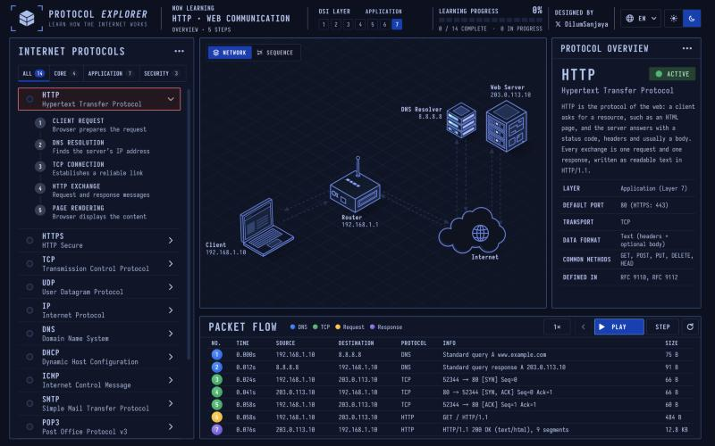
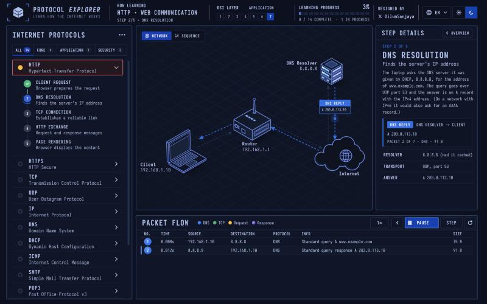
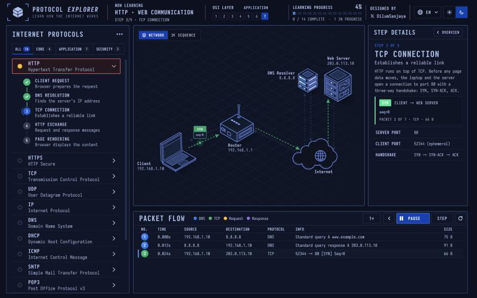
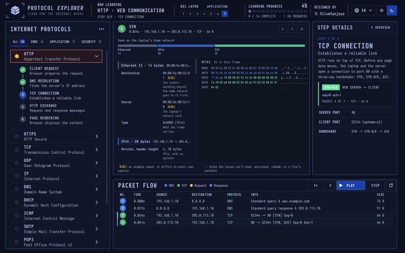
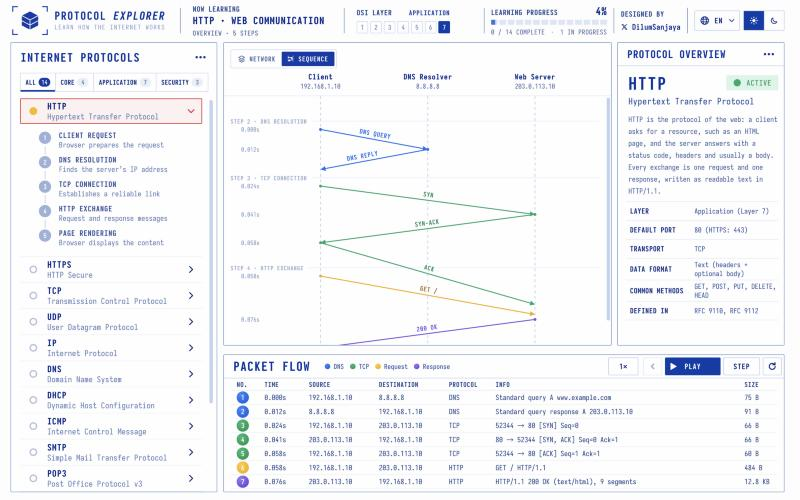
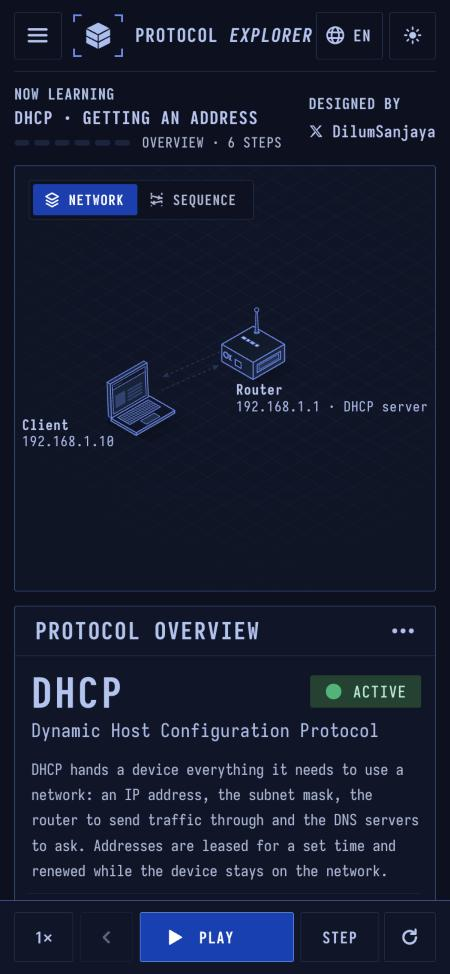
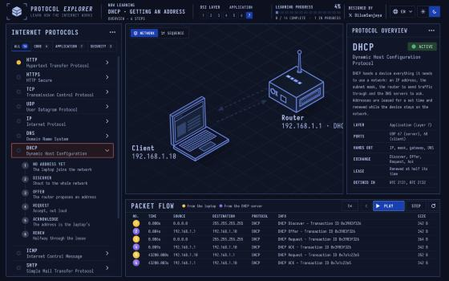

# TechConcepts: Reference Research

Research date: 2026-11-03. Two references were studied:

1. **Protocol Explorer** (https://protocol-explorer-alpha.vercel.app): the model for the Concept Explanation page.
2. **TryHackMe** Pre Security and SOC Level 1 paths: the model for how content is structured and delivered.

Screenshots are in `img/`.

---

## Part 1: Protocol Explorer (detailed inspection)

### What it is

A single-page interactive lab that teaches 14 internet protocols by *showing* them. You watch packets move across a network diagram, step by step, and you can decode any packet field by field. It has no accounts, quizzes or typing. It is a "watch and inspect" simulator, not a "do it yourself" one.

Built with Vite (one JS bundle and one CSS bundle) and hosted on Vercel. By Dilum Sanjaya.

### Page layout (desktop, ~1440px)



The page is one screen with no scrolling: a top bar plus a CSS grid workspace.

```
┌──────────────────────────────────────────────────────────────────────────────┐
│ [logo] PROTOCOL EXPLORER │ NOW LEARNING      │ OSI LAYER   │ LEARNING      │ credit │ EN │ ☀☾ │
│        Learn how the...  │ HTTP · Web comm.  │ [1..7] chips│ PROGRESS 4%   │        │    │    │
│                          │ Step 3/5 · TCP    │             │ ▮▮▯▯… 0/14    │        │    │    │
├────────────────────┬──────────────────────────────────────┬──────────────────┤
│ INTERNET PROTOCOLS │  [NETWORK | SEQUENCE] toggle          │ PROTOCOL OVERVIEW│
│ [All 14][Core 4]   │                                       │  or STEP DETAILS │
│ [Application 7]    │   isometric network diagram           │                  │
│ [Security 3]       │   (or sequence diagram,               │  name + badge    │
│                    │    or packet inspector)               │  description     │
│ ▸ HTTP  (open)     │                                       │  key/value facts │
│   1 Client request │                                       │                  │
│   2 DNS resolution │                                       │                  │
│   3 TCP connection │                                       │                  │
│ ▸ HTTPS            ├───────────────────────────────────────┴──────────────────┤
│ ▸ TCP …            │ PACKET FLOW  ● DNS ● TCP ● Request ● Response   [1×][‹][▶ PLAY][STEP][↻] │
│                    │ NO. TIME  SOURCE  DESTINATION  PROTOCOL  INFO           SIZE │
│                    │ ①  0.000s 192.168.1.10 → 8.8.8.8  DNS  Standard query…  75 B │
└────────────────────┴──────────────────────────────────────────────────────────┘
```

- **Grid:** `372px | minmax(0,1fr) | 300px` columns. Rows are ~546px for the canvas and ~248px for the packet table. The left sidebar spans both rows.
- **Breakpoints:** JS sets `data-layout` on `<html>` to `phone`, `narrow`, `medium` or `wide`. Each layout hides or shrinks parts: the OSI chips disappear on narrow and phone, and Learning Progress disappears on phone.

### The regions, one by one

**Top bar**
- Brand: a cube logo inside corner-bracket "viewfinder" marks. The wordmark is "PROTOCOL *EXPLORER*" (second word italic), with the tagline "LEARN HOW THE INTERNET WORKS" in small, widely spaced caps.
- **Now Learning:** the current protocol and lesson name ("HTTP · WEB COMMUNICATION"). Below it, a row of dash segments (one per step) and a status line: "Overview · 5 steps", which becomes "Step 3/5 · TCP connection" during playback.
- **OSI Layer:** chips numbered 1 to 7, with the current protocol's layer filled in. The layer name ("APPLICATION") sits above.
- **Learning Progress:** a percentage, a segmented bar (one segment per protocol), and "0 / 14 COMPLETE · 1 IN PROGRESS".
- Tools: language menu (14 languages, including the right-to-left languages Arabic and Hebrew) and a light/dark segmented toggle.

**Left sidebar: Internet Protocols**
- Category tabs with counts: All 14, Core 4, Application 7, Security 3.
- A list of protocols (HTTP, HTTPS, TCP, UDP, IP, DNS, DHCP, ICMP, SMTP, POP3, IMAP, FTP, SSH, TLS/SSL). Each row shows a status dot (empty, amber for in progress, green for done), the short name, the full name and a chevron.
- The active row has a red-pink outline on a dark red tint.
- Expanding a row shows its **lesson steps**, numbered. Each step has an uppercase title and a one-line description, for example "3 · TCP CONNECTION / Establishes a reliable link". Steps turn into green checkmarks as you complete them, and the current step shows a blue ring.

**Center canvas (three modes)**
1. **Network view:** an isometric line-art topology (laptop, router, DNS server stack, web server, internet cloud) on a faint blueprint grid. Every node is labeled with its name and IP. Devices are connected by dashed lines, and more nodes exist off-screen for other lessons (root DNS, TLD, authoritative and mail servers).
2. **Sequence view:** lifelines for the actors (Client, DNS Resolver, Web Server) with their IPs. Horizontal bands mark the steps ("STEP 3 · TCP CONNECTION"), and colored diagonal arrows are labeled SYN, SYN-ACK, ACK, GET /, 200 OK, with timestamps in the left margin.
3. **Packet inspector:** opens when you click a packet row and replaces the canvas (details below).

**Right panel: Protocol Overview ↔ Step Details**
- **Overview state:** a large protocol name (31px, weight 800), a green "● ACTIVE" badge, the full name, a 3–4 sentence plain-English description, then a fact table: Layer, Default port, Transport, Data format, Common methods, Defined in (RFCs).
- **Step state** (during playback): an "‹ OVERVIEW" back button, "STEP 2 OF 5", the step title in big caps, a subtitle, and a short narrative paragraph. Then comes a **packet card** (a colored badge such as `DNS REPLY`, "DNS RESOLVER → CLIENT", a summary like "A 203.0.113.10", and "PACKET 2 OF 7 · DNS · 91 B"), followed by step-specific facts (Resolver, Transport, Answer).

**Bottom: Packet Flow**
- A legend with colored dots (DNS blue, TCP green, Request amber, Response violet). The legend changes per lesson; for DHCP it reads "From the laptop / From the DHCP server".
- Controls: speed (1×), previous step, **PLAY/PAUSE** (primary blue, Space key), STEP, and replay.
- A Wireshark-style table: No., Time, Source, Destination, Protocol, Info, Size. The number is a colored circle matching the legend. In overview mode the table is full. During playback it starts empty ("No packets on the wire yet.") and rows appear as packets are sent.

### How a lesson plays (the interaction model)

| State | Canvas | Right panel | Table |
|---|---|---|---|
| Overview | Full topology, idle | Protocol overview + facts | All packets listed |
| Press PLAY → Step 1 | Camera **zooms onto the active device** (the laptop with a URL bar) | Step 1 narrative + facts (URL, Method, Next hop) | Empty |
| Step 2 | Zooms out. A labeled packet chip ("DNS REPLY · A 203.0.113.10") travels along a dashed line | Step 2 + packet card | Rows 1–2 appear |
| Step 3 | A "SYN seq=0" chip travels laptop → router → internet → server | Step 3 + handshake facts | Row 3 appears, then 4… |
| Any time | Click a row → **packet inspector** | (unchanged) | Selected row highlighted |

The top bar, sidebar checkmarks and the Learning Progress % all update as you go. Views crossfade when switching (a slight zoom plus fade).




### Packet inspector (the standout feature)



- **Header:** a numbered badge, the packet name ("SYN"), and "0.024s · 192.168.1.10 → 203.0.113.10 · TCP · 66 B", with prev, next and close buttons.
- **Context line:** "Seen on the laptop's home network".
- **Layer bar:** a stacked bar showing the bytes per layer, labeled Ethernet 14, IPv4 20, TCP 32.
- **Field tree:** collapsible sections ("Ethernet II · 14 bytes", "IPv4 · 20 bytes", "TCP · 32 bytes"). **Every field has its value plus a one-line plain-English explanation**, for example: *Time to live: 128. "Windows starts at 128."* or *Flags: DF. "Routers must not split it; if it's too big they report back instead."*
- **"E.G." tags** mark example values that would differ in a real capture. This is an honest-teaching device.
- **Hex dump:** offset, hex bytes and ASCII, "66 in this frame". A legend notes that "··" marks bytes the lesson can't show (encrypted or random).

This is Wireshark's three-pane layout (list / tree / bytes), rewritten so a beginner can read it.

### Visual language and design tokens

**Typography:** **Iosevka** (monospace) for everything, with per-script fallbacks for CJK, Devanagari, Arabic and Hebrew.
- Titles: weight 800, uppercase, letter-spacing 0.05–0.12em. The panel title is 21px/32px, the protocol name 31px/40px, and the brand 20px.
- Body: 13–16px. Table cells 13px/500, table headers 12px/800.

**Shape:** 1px borders, **2px radius**, **no shadows**, flat panels. Isometric line-art devices with soft blue fills. Dashed connector lines.

**Dark theme (default):**

| Token | Value | Use |
|---|---|---|
| `--bg` | `#0b1020` | page |
| `--panel` | `#0f1628` | panels |
| `--line` | `#3c649f` | panel borders |
| `--line-mid` | `#1d304e` | dividers |
| `--line-soft` | `#1a283e` | subtle rules |
| `--ink` | `#afc4f2` | body text |
| `--ink-strong` | `#b7c6f3` | titles |
| `--ink-soft` | `#acb8d3` | secondary |
| `--ink-muted` | `#859cc9` | captions |
| `--green` | `#00ef98` | active, done, TCP |
| `--amber` | `#f8b900` | in progress, request |
| `--blue` | `#0a78f5` | DNS |
| `--active` | `#1f5fe0` | primary button, selection |
| violet | `#7656e0` | response |
| selected row | `#e2626b` border on `#251620` | the active protocol |

**Light theme:** near-white `#fdfdfe` background, navy ink `#0032a0`, light-blue lines (`#6f94c9`, `#e3e9f3`). The same structure, reading like a blueprint on paper.



**Motion:** `--ease-out: cubic-bezier(.16,1,.3,1)` and `--ease-in: cubic-bezier(.5,0,.75,0)`. Camera zoom, traveling packet chips, crossfades.

**Token architecture:** raw colors named by their light-mode hex (`--k-fill-0b3aa8`), each remapped under `[data-theme="dark"]`. Semantic aliases (`--ink`, `--line`, `--panel`) sit on top. This makes theming mechanical.

### Mobile



The sidebar becomes a drawer (hamburger, top-left), and the panels stack: Now Learning → canvas → Overview → table. A **sticky bottom playback bar** (1×, ‹, PLAY, STEP, ↻) stays within thumb reach.

### Per-lesson variation (DHCP example)



The DHCP lesson uses the same shell with a different cast and script: only the Client and the Router (as the DHCP server), and 6 steps (No address yet → Discover → Offer → Request → Acknowledge → Renew). The legend becomes "From the laptop / From the DHCP server", and the fact table shows Ports (UDP 67/68), Hands out, Exchange and Lease. So **each lesson is data**: actors, steps, packets, facts and narration, played by one engine.

### What to borrow and what's missing for TechConcepts

Borrow:
- The three-pane "lab console": navigation, live visualization, and an explanation panel.
- One step = a short narrative + one visible event + a few key facts.
- An inspector that explains every field in plain English, and the "E.G." honesty tags.
- Lessons defined as data and played by a shared engine.
- A persistent "Now learning" bar and a global progress meter.
- A dark blueprint aesthetic that also works in light mode.

Missing (TryHackMe supplies these):
- Questions and checks for understanding, and points.
- Anything the learner *types or configures*: terminal commands, router config.
- Accounts and saved progress, paths and certificates.
- Guided storylines and personas.

---

## Part 2: TryHackMe content design and delivery

> Note: TryHackMe's scripts did not run in the browser pane, so pages showed unstyled and sign-in wasn't possible there. All room and path *content* below was readable. Visual UI notes marked *(general knowledge)* were not seen this session. Premium rooms show only Task 1 to non-subscribers.

### Content hierarchy

```
Learning Path ─┬─ Section (= module) ─┬─ Room ── Task ── Question(s)
               │                      ├─ Topic Rewind Recap   (end of every section)
               │                      └─ SOC Simulator scenario (some sections)
               ├─ Capstone challenges (final section)
               ├─ Certificate of Completion
               └─ Linked pro certification (SEC0 / SAL1)
```

### Path landing page pattern

- An eyebrow ("Learning path"), the title, a one-paragraph promise.
- **Stats strip:** Modules, Hands-on labs, Estimated time, Difficulty.
- An Enroll button.
- **4 outcome bullets** ("Learn SOC tools and operations", "Monitor endpoints for threats"…).
- Certificate of Completion and pro-cert cards.
- An introduction paragraph, then the numbered sections. Each section lists its rooms as chips, ending with a "Topic Rewind Recap".

### Pre Security (2026 revamp): 7 modules · 31 labs · 19h 10m · easy

| # | Section | Rooms |
|---|---|---|
| 1 | Introduction to Cyber Security | Offensive Security Intro · Defensive Security Intro · Careers in Cyber |
| 2 | Computer Fundamentals | Inside a Computer System · Computer Types · Client-Server Basics · Virtualisation Basics · Cloud Computing Fundamentals |
| 3 | Operating Systems Basics | OS: Introduction · Windows Basics · Linux CLI Basics · Windows CLI Basics · OS Security |
| 4 | Software Basics | Data Representation · Data Encoding · Python: Simple Demo · JavaScript: Simple Demo · Database SQL Basics |
| 5 | Network Fundamentals | What is Networking? · Intro to LAN · OSI Model · Packets & Frames · Extending Your Network |
| 6 | How The Web Works | DNS in Detail · HTTP in Detail · How Websites Work · Putting it all together |
| 7 | Attacks and Defenses | The CIA Triad · Cryptography Concepts · Become a Hacker · Become a Defender |

Outcomes: how computers work → first code → networking and web → think like an attacker or defender. Leads to the **SEC0** cert.

### SOC Level 1: 14 modules · 65 labs · 65h 29m · easy

| # | Section | Rooms (+ SOC Sim scenario) |
|---|---|---|
| 1 | Blue Team Introduction | Junior Security Analyst Intro · SOC Role in Blue Team · Humans as Attack Vectors · Systems as Attack Vectors |
| 2 | SOC Team Internals | SOC L1 Alert Triage · Alert Reporting · Workbooks and Lookups · Metrics and Objectives · *Sim: Introduction to Phishing* |
| 3 | Core SOC Solutions | Intro to EDR · Intro to SIEM · Splunk: The Basics · Elastic Stack: The Basics · Intro to SOAR |
| 4 | Cyber Defence Frameworks | Pyramid of Pain · Cyber Kill Chain · Unified Kill Chain · MITRE · Summit · Eviction |
| 5 | Phishing Analysis | Fundamentals · Emails in Action · Analysis Tools · Prevention · The Greenholt Phish · Snapped Phish-ing Line · *Sim: Phishing Unfolding* |
| 6 | Network Traffic Analysis | Network Traffic Basics · Wireshark: The Basics · Packet Operations · Traffic Analysis · NetworkMiner |
| 7 | Network Security Monitoring | Essentials · Network Discovery Detection · Data Exfiltration Detection · MitM Detection · IDS Fundamentals · Snort |
| 8 | Web Security Monitoring | Essentials · Detecting Web Attacks · Web Shells · Web DDoS · *Sim: Upload and Conquer* |
| 9 | Windows Security Monitoring | Windows Logging for SOC · Threat Detection 1–3 |
| 10 | Linux Security Monitoring | Linux Logging for SOC · Threat Detection 1–3 · *Sim: BlackCat* |
| 11 | Malware Concepts for SOC | Malware Classification · Intro to Malware Analysis · Living Off the Land · Shadow Trace |
| 12 | Threat Analysis Tools | Intro to CTI · File and Hash TI · IP and Domain TI · Invite Only |
| 13 | SIEM Triage for SOC | Log Analysis with SIEM · Alert Triage with Splunk · with Elastic · ItsyBitsy · Benign |
| 14 | Capstone Challenges | Tempest · Boogeyman 1–3 · *Sims: Hidden Hooks, Open Door* |

The pattern: each module mixes **concept rooms** with a **named challenge room** at the end (Summit, Eviction, Greenholt Phish, Shadow Trace, ItsyBitsy) that applies the module with less hand-holding. SOC Simulator scenarios are interleaved after key modules. Leads to the **SAL1** cert.

### Room anatomy

- **Header:** title, a one-line description, difficulty (easy/medium), time (15–120 min), learner count, and Help / Recommend / Room Info. Some rooms open with a video.
- **Task 1 "Introduction":** a hook (an analogy or storyline), **Learning Objectives** (3–5 bullets), **Prerequisites** (linked earlier rooms), and the environment setup if there is one. Its question is usually a confirm step like "Let's get started!" or "I am ready to start!"
- **Tasks 2…N:** one concept per task, 300–900 words. Prose, then a diagram or screenshot, then a summary table, then a short process list.
- **Final task "Conclusion":** recaps the room, explains why it matters later, and names the next room ("Continue to the next room *Computer Types*").

### Task and question anatomy

Each task ends with **"Answer the questions below"** and 1–4 questions. The types seen:

| Type | Example |
|---|---|
| Key-term recall | "What is the key term for devices that are connected together?" |
| Fact from the reading | "Who invented the World Wide Web?" |
| Confirm / continue | "I am ready to discover the different types of computer systems!" |
| Yea/Nay judgement | "Should you first take the newest alerts and then the older ones? (Yea/Nay)" |
| Flag from a simulation | "Give in the flag you received after completing the exercise on the static site." |
| Do-an-action-then-report | "Assign yourself to the first-priority alert and change its status to In Progress. The name of your selected alert will be the answer." |
| Find in the environment | "What was the malicious IP address in the alerts?" / "To whom did you escalate the alert?" |

*(General knowledge)* Answers are typed into a short input with an answer-format mask, a Submit button and an optional Hint. Correct answers award points, and completed tasks turn green.

### The hands-on delivery ladder (from lightest to heaviest)

1. **Text only:** read, then answer.
2. **"Task includes website · View Site":** a *static in-browser simulation* opens in split screen. You complete an exercise and receive a **flag** to submit. Pre Security relies on these heavily: drag PC components onto body-part analogies, order the boot sequence, or play a mini SOC dashboard where you find a malicious IP, escalate it to a named colleague and block it on the firewall.
3. **Attached web app ("Click to Open"):** e.g. the TryHackMe SIEM "SOC Dashboard", a shared app used across several tasks.
4. **"Task includes a deployable machine":** a "Start Lab Machine" button with a status (Off/On) and a split-screen VM. Some rooms also have an AttackBox. Credentials come in a table (Username / Password / IP `MACHINE_IP` / Connection via RDP). Tasks reference files on the VM (e.g. `Exercise.pcapng`).
5. **SOC Simulator scenarios:** a realistic alert queue to triage end to end.
6. **Capstone challenge rooms:** minimal teaching, structured around attack phases (Tempest: Initial Access → Stage 2 → Discovery → PrivEsc → Actions on Objective).

**Key takeaway for TechConcepts:** beginners in Pre Security almost never touch a real VM. Levels 2 and 3 (browser simulations ending in a flag) do most of the hands-on work. Real machines come in later. Protocol Explorer is essentially an excellent level-2 simulation.

### Voice and pedagogy

- **Second person, warm, reassuring:** "Don't worry about too much technical jargon", "Each step in this room will guide you through exactly what to do."
- **Analogy-first:** a castle you must defend, the human body as PC parts, friendship circles as networks, Alice/Bob/Jim, names vs fingerprints (IP vs MAC).
- **Storyline and role-play:** "Your first day as an IT Support Engineer… your supervisor left you a note", or "Meet your colleagues" with named personas (Will, Senior Analyst; Corey, SOC Engineer; Emily, SOC Manager; Daniel, Incident Responder), each with a one-line job description.
- **Job-relevance framing:** "the same basic skills that cyber security professionals use every day", and explicit cert prep ("Prepare for SOC Simulator and SAL1 certification").
- **Structured reference tables:** e.g. eight alert properties, each with a description and examples, severity emoji scales and status lifecycles.
- **Process recipes:** "Filter → Sort by severity → Sort by time", or the reference alert-triage flow diagram.
- **Continuity:** every room links back (prerequisites) and forward (the conclusion).

### Business and gating patterns

- Free and Premium rooms. A Premium room shows **Task 1 in full** (the hook, objectives and first question), then lists the remaining task titles as locked. It's an effective teaser.
- Paths end with a free certificate of completion and point to a paid professional cert.
- *(General knowledge)* Gamification includes points, daily streaks, weekly leagues, badges, ranks and a public profile.

---

## Part 3: Early implications (for discussion, not decided)

- The **Concept Explanation page** could be Protocol Explorer's three-pane console with a TryHackMe task layer: the left sidebar becomes room → tasks, the right panel becomes task narrative + questions, and the center is a pluggable simulation.
- Simulation types that cover the target certs and roles: **packet flow** (Network+, CCNA), **terminal** (nmap and Linux for Security+/OSCP), **device config** (Cisco IOS CLI for CCNA), **alert queue / SIEM** (SOC Analyst, CySA+), **ticket desk** (Helpdesk T1/T2), **query console** (SQL for Data Analyst).
- Flags from simulations give "proof of doing" without running real VMs early on.
- Each lesson as data (actors, steps, events, facts, questions) played by shared engines. This is the main lesson from Protocol Explorer's architecture.
